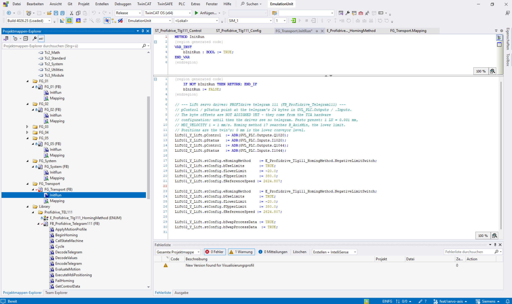

# Lift drives — PROFIdrive telegram 111

The two lift carriages in `FGTransport` are servo axes. The TIA program controls each one as a
**PROFIdrive standard telegram 111 drive** (EPOS basic positioner, MDI). In the emulation unit each
drive is simulated by `FB_Profidrive_Telegram111` in `TIA_1/EmulationUnit/SIM_1/Library/Profidrive_TEL111/`.

## Where the behaviour comes from

The behaviour was tested first against the TIA program as realvirtual Unity scripts
(`_data/UnityDevScripts`: `ProfidriveAxisBase`, `Drive_Telegram111`, `FestoAxis`,
`ProfidriveMotionProfile`, Festo preset). `FB_Profidrive_Telegram111` is a one-to-one port of
those scripts and keeps the order of every decision.

It is built the Open Commissioning way, like `FB_SEW_MoviC_Position` in **OC_Profinet**:

- **State machine:** OC_Profinet `FB_ProfidriveGSM`, the PROFIdrive general state machine (S1 to
  S4, S51 ramp stop, S52 quick stop). Fault, STO and CTRL-EN are handled on top of it.
- **Process data:** `pControl` / `pStatus` point into the PLCSIM image. The words are copied field
  by field with byte swap, because Siemens data is big-endian.
- **Position output:** `ControlData` carries the position in mm to the Unity `DrivePosition`,
  which follows it exactly.
- **Motion profile:** the scripts' trapezoid integrator, in 1 ms sub-steps. Velocity and override
  act live, the axis never reverses before standstill, and it snaps onto the target.

## Telegram layout

24 bytes in each direction, big-endian.

| PZD | PLC → drive (`%QB`) | Drive → PLC (`%IB`) |
|---:|---|---|
| 1 | STW1 | ZSW1 |
| 2 | POS_STW1 | POS_ZSW1 |
| 3 | POS_STW2 | POS_ZSW2 |
| 4 | STW2 (not evaluated) | ZSW2 (not written) |
| 5 | OVERRIDE, 16#4000 = 100 % | MELDW (not written) |
| 6–7 | MDI_TARPOS [LU] | XIST_A [LU] |
| 8–9 | MDI_VELOCITY | NIST_B, 16#40000000 = reference speed |
| 10 | MDI_ACC, 16#4000 = 100 % | FAULT_CODE (not written) |
| 11 | MDI_DEC, 16#4000 = 100 % | WARN_CODE (not written) |
| 12 | — | — |

## Telegram addresses and TwinCAT configuration

The local `FG_Transport.InitRun` implementation connects each simulated drive to 24 bytes in each direction:

| Drive | Status (drive → PLC) | Control (PLC → drive) |
|---|---|---|
| Lift01 | `%IB1020` … `%IB1043` | `%QB1020` … `%QB1043` |
| Lift02 | `%IB1044` … `%IB1067` | `%QB1044` … `%QB1067` |

```iecst
Lift01_Y_Lift.pControl := ADR(GVL_PLC.Outputs.Q1020);
Lift01_Y_Lift.pStatus  := ADR(GVL_PLC.Inputs.I1020);
Lift02_Y_Lift.pControl := ADR(GVL_PLC.Outputs.Q1044);
Lift02_Y_Lift.pStatus  := ADR(GVL_PLC.Inputs.I1044);
```

Match these byte addresses to the telegram start addresses in the TIA hardware configuration. The adapter's TIA hardware identifiers are not byte offsets and must not be substituted here.



This screenshot documents the **TwinCAT simulation configuration**, not the modular Siemens actuator call. The old comment “NOT ASSIGNED YET” visible above the pointer assignments is stale; the assignments underneath are active.

For both simulated lifts, the shown configuration selects `NegativeLimitSwitch`, enables a physical travel clamp from −20 to 380 mm, and enables `bSwapProcessData` for the Siemens process image. Keep the PLC's scaling and the emulation configuration consistent.

**Screenshot note:** The captured Lift02 section still shows a reference-speed assignment to `Lift01_Y_Lift`. This has been corrected in the supplied code: `FG_Transport.InitRun` explicitly sets `stConfig.fReferenceSpeed := 2624.807` for both Lift01 and Lift02. Use the supplied source rather than copying this line from the screenshot, and keep the reference speed consistent with the PLC parameters.

The limit sensors are wired twice:

- to the TIA program on the former cylinder bits: `%I1012.2` / `.3` for Lift01 and `%I1013.2` /
  `.3` for Lift02 (`B_AxisMin` / `B_AxisMax`);
- to the drive as its hardware limit switches.

`%Q1012/1013.0/.1` are free.

## Scaling and parameters (Festo preset)

| Parameter | Value |
|---|---|
| Position | 1 LU = 0.001 mm |
| MDI_VELOCITY | 1 = 1 mm/s, read as an unsigned integer |
| Jog 1 / jog 2 | +/− 50 mm/s at 100 % override |
| Acceleration / deceleration | 1000 mm/s² base; MDI_ACC / MDI_DEC scale it in MDI |
| Homing | method **17**, search the negative limit `B_AxisMin` at 10 mm/s, back off at 5 mm/s, reference on the release edge (XIST_A = 0), timeout 120 s |
| Hardware limit monitoring | on; the PLC must also set POS_STW2.15 |
| Travel clamp | −20 … 380 mm (the twin's coordinates; 0 mm is the lower conveyor level) |

`NIST_B` uses `stConfig.fReferenceSpeed`, 1000 mm/s by default. It must match the reference
velocity the TIA program uses. All parameters are in `stConfig` and are set in `FG_Transport.InitRun`.

## What the PLC sees, and the deliberate quirks

The model reports what the scripts reported when they were tested:

- **ZSW1.4 / .5 / .9** echo STW1.1 / .2 / .10.
- **ZSW1.8** (following error within tolerance) is always 1.
- **ZSW1.12** is a level handshake with STW1.6.
- **Jog 1** moves positive and **jog 2** moves negative.
- **Set reference point** (POS_STW2.1) and homing set XIST_A = 0 at the current position. The
  axis is never moved for that.
- **A hardware limit** rejects commands toward it. It does not brake a move already under way;
  only the travel clamp does.
- **Fault acknowledge** (STW1.7 edge) returns to S1. The PLC then has to switch OFF1 off and on
  again.

**Not modelled:** traversing blocks, STW2/ZSW2 sign of life, MELDW, fault and warning codes,
incremental jog, software limit switches, following error, modulo axes.
